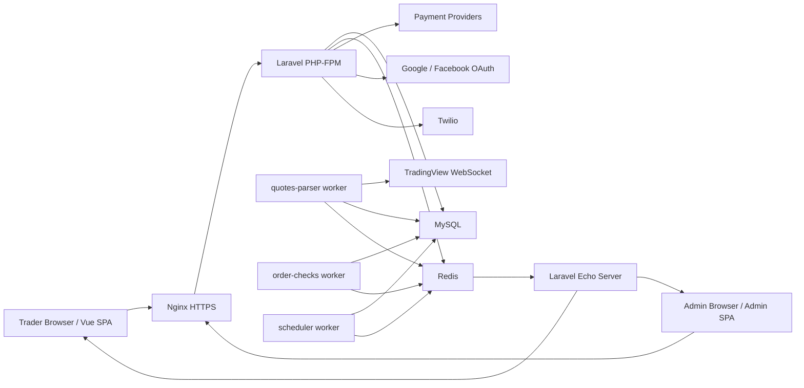
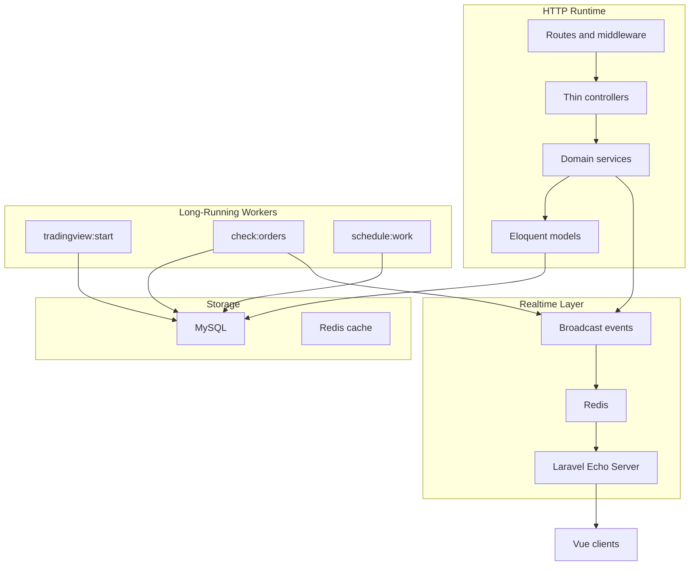
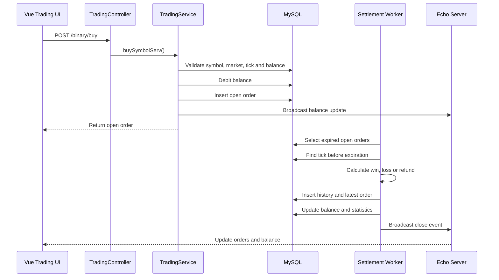
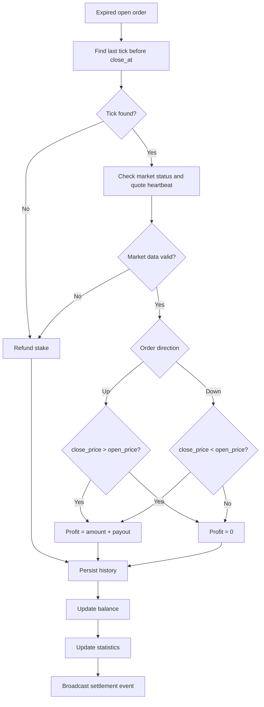
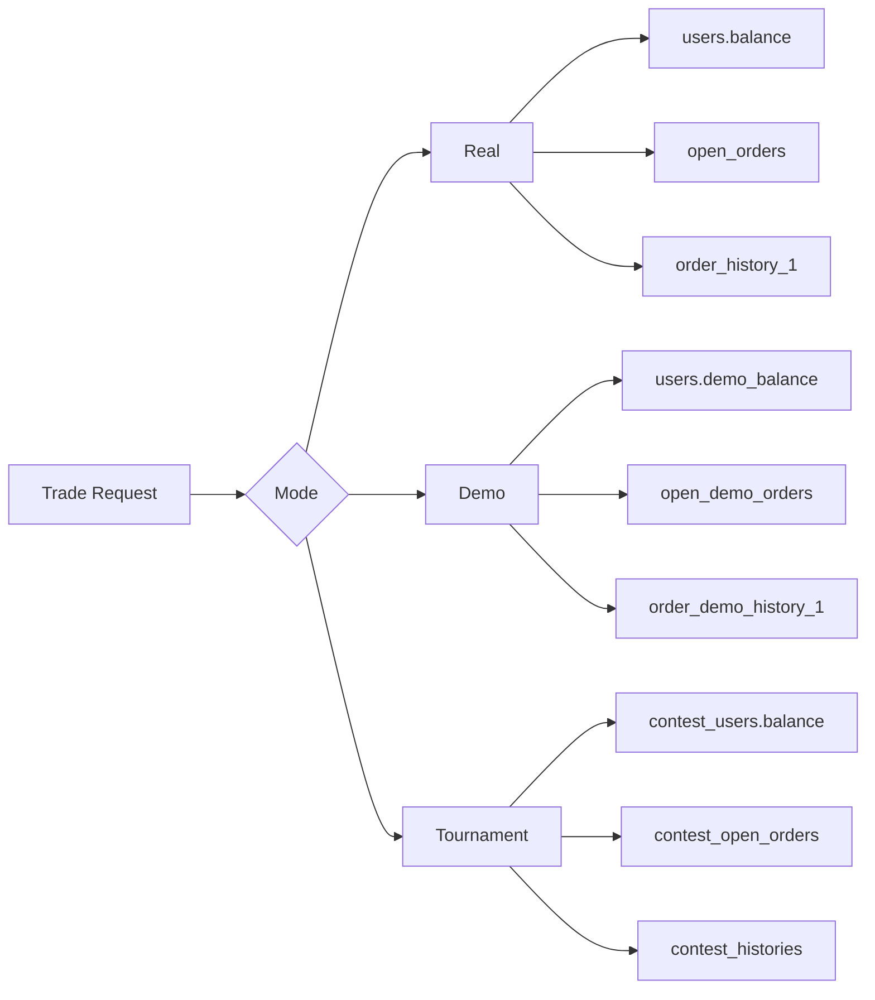
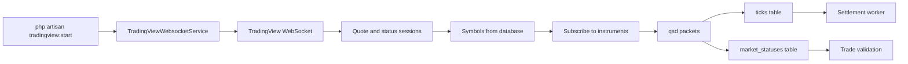
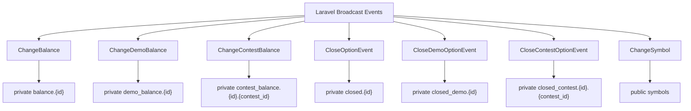
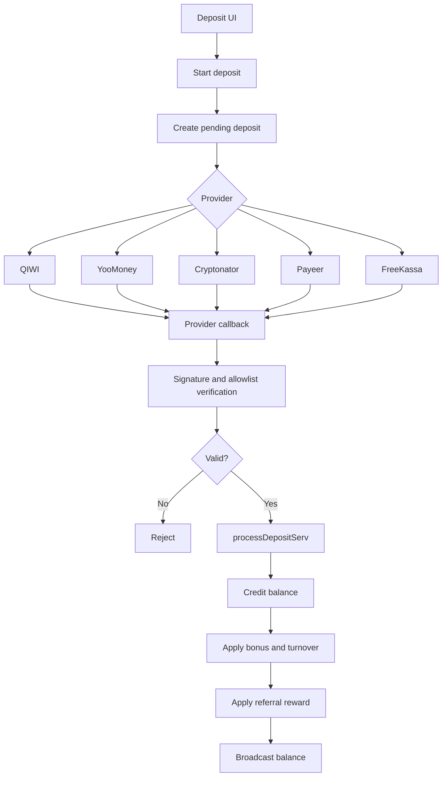
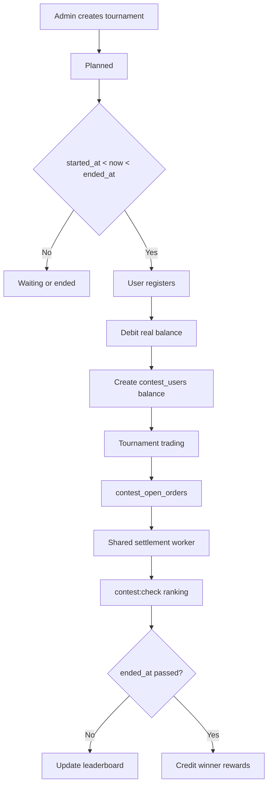

# BinaryOptionsCMS

Full-stack realtime trading platform for binary options, built as a Laravel and Vue application with dedicated workers for market data ingestion, order settlement, realtime notifications, payments, tournaments, KYC and administrative operations.

This repository represents a complete product architecture rather than a simple trading UI. It combines a user-facing trading terminal, an operational admin panel, background settlement services, payment-provider callbacks, dynamic payout management, private websocket events and risk-control workflows.

## Executive Summary

BinaryOptionsCMS is a monolith-first financial platform with separated runtime responsibilities. The Laravel application owns the domain model and HTTP/API surface, while long-running workers handle realtime quote ingestion, option settlement and scheduled maintenance. Vue powers the trading and admin interfaces, TradingView Charting Library provides the market terminal experience, and Laravel Echo Server delivers account and order updates in realtime.

The system was designed around several high-value product requirements:

- accept binary option trades only when symbol, market, expiration and account rules pass;
- ingest live quote data from TradingView through persistent websocket sessions;
- settle expired options against timestamped tick data outside the HTTP request lifecycle;
- keep balances, open positions and close results synchronized without polling;
- support real, demo and tournament trading modes;
- process deposits through multiple payment providers;
- enforce verification, turnover and anti-fraud constraints before withdrawals;
- give administrators operational controls over symbols, users, balances, payouts, KYC, tournaments and payment systems.

## Product Surface

| Area | Capabilities |
| --- | --- |
| Trading terminal | Real/demo/tournament trading, TradingView chart, expiration controls, dynamic payouts, open and latest orders |
| Market data | TradingView websocket ingestion, tick storage, market status tracking, historical bar loading |
| Settlement engine | Expiration scan, close-price lookup, win/loss/refund calculation, history records, balance updates |
| Realtime updates | Private balance channels, close-order channels, symbol payout broadcasts |
| Finance | Deposits, withdrawals, payment callbacks, exchange-rate conversion, bonus turnover |
| Growth | Promocodes, referral tracking, partner requests and reward accounting |
| Tournaments | Registration, isolated contest balance, tournament orders, ranking, rewards |
| Admin panel | User control, symbol configuration, KYC, deposits, payouts, settings, statistics |
| Security controls | Auth, admin middleware, CSRF, private channel authorization, IP/user-agent tracking, ban states |

## Screenshots

### Trading And Admin Views

<p>
  
  
</p>

<p>
  

</p>

### Supporting Product Screens

<p>
  
  

</p>

<p>
  
  
</p>

## High-Level Architecture



## Runtime Decomposition

The platform keeps the codebase cohesive but separates runtime responsibilities into dedicated long-running processes.



## Trade Lifecycle



## Order Settlement Engine



## Trading Modes



## Market Data Pipeline



## Realtime Event Model



## Payment Flow



## Tournament Lifecycle



## Core Backend Modules

| Module | Responsibility |
| --- | --- |
| `app/Services/MainHttp/TradingService.php` | Trade placement, open/latest orders, history, demo balance |
| `app/Services/Console/TradingViewWebsocketService.php` | TradingView quote ingestion and market status updates |
| `app/Services/Console/CheckOrdersForCloseService.php` | Expired order settlement and statistics updates |
| `app/Services/Console/SetSymbolsPercentService.php` | Dynamic payout recalculation |
| `app/Services/MainHttp/DepositService.php` | Deposit creation, provider callbacks, bonuses, referral credit |
| `app/Services/MainHttp/WithdrawalService.php` | Withdrawal requests, balance and KYC checks |
| `app/Services/MainHttp/ContestService.php` | Tournament registration, balances, rankings and histories |
| `app/Services/Admin/*` | Operational administration, KYC, users, symbols, payments, settings |

## Technology Stack

| Layer | Technologies |
| --- | --- |
| Backend | PHP 8, Laravel 8, Eloquent, Laravel Passport |
| Frontend | Vue 2, Vue Router, Bootstrap Vue, Axios, i18n |
| Charts | TradingView Charting Library, custom JavaScript datafeed |
| Realtime | Laravel Broadcasting, Redis, Laravel Echo Server, Socket.IO |
| Storage | MySQL, Redis, PostgreSQL config, ClickHouse config |
| Workers | Laravel Artisan commands, scheduler, Docker services |
| Payments | PayHero M-Pesa STK Push, QIWI, YooMoney, Cryptonator, Payeer, FreeKassa |
| Integrations | Google OAuth, Facebook OAuth, Twilio, GeoIP, CBR rates |
| Build | Laravel Mix, Webpack, npm |
| Infrastructure | Docker Compose, Nginx, PHP-FPM |

## Operational Processes

| Command | Role |
| --- | --- |
| `php artisan tradingview:start` | Starts persistent quote parsing from TradingView |
| `php artisan check:orders` | Starts settlement loop for expired orders |
| `php artisan schedule:work` | Runs scheduled maintenance tasks |
| `php artisan clear:ticks` | Removes old tick data |
| `php artisan set:percent` | Recalculates symbol payout percentages |
| `php artisan exchange:rate` | Updates exchange rates |
| `php artisan contest:check` | Updates tournament ranking and rewards |
| `laravel-echo-server start` | Starts realtime event gateway |

## Engineering Significance

The project demonstrates engineering work across several complex areas that are usually separated across multiple teams:

- realtime financial UI with charting and websocket-driven updates;
- market data ingestion through a non-trivial websocket protocol;
- deterministic order settlement based on tick timestamps;
- financial account state transitions for real, demo and contest balances;
- payment callback verification across multiple providers;
- bonus and turnover accounting;
- private realtime event authorization;
- operational administration for users, symbols, KYC, payouts and contests;
- background workers and scheduler-driven maintenance;
- Dockerized deployment with separate runtime roles.

Strong technical framing:

> I designed and implemented a realtime trading platform architecture that separated user-facing HTTP flows from market data ingestion and order-settlement workers. The platform accepted trades only after validating market state, symbol configuration, account balance and expiration rules, then settled expired options against timestamped tick data and synchronized balances through private realtime channels.

## Repository Structure

```text
app/
  Console/Commands        Artisan entrypoints for workers and scheduler tasks
  Events                  Broadcast events for balances, symbols and order closes
  Http/Controllers        Main, Admin, Auth and SPA controllers
  Http/Middleware         Auth, admin, locale and anti-fraud middleware
  Http/Requests           FormRequest validation classes
  Models                  Eloquent domain models
  Services                MainHttp, Admin and Console service layers

resources/
  vuejs                   User and admin Vue applications
  assets/js               TradingView datafeed and streaming integration
  views                   Blade layouts and panels

routes/
  web.php                 Main application, SPA, payment callback and admin routes
  api.php                 Passport API auth routes
  channels.php            Broadcast channel authorization

database/
  migrations              Domain schema evolution

env-ci/
  local, prod             Docker Compose environments and service Dockerfiles
```

## Local Database Setup

For local development without MySQL or ClickHouse, configure `DB_CONNECTION=sqlite` and point `DB_DATABASE` at a SQLite file, then run `php artisan migrate` and `php artisan install` to create the starter symbols and other initial application data. Market-status, quote, and tick models use SQLite in this mode. When a ClickHouse host is configured, quote and tick storage remains on ClickHouse; market statuses use the configured default database connection.

The trading chart also needs the local TradingView websocket relay. Set `WEBSOCKET_HOST=127.0.0.1:8081` and run `npm run dev:tradingview-proxy` in a separate terminal while developing locally. The relay reads the local app origin and port from `APP_URL` in `.env`; set `APP_PORT` only if you need to override that port. The relay only listens on loopback and accepts connections from the local app origin. To populate live market status and ticks used by trade controls, run `php artisan tradingview:start` in another terminal and keep it running; it connects directly to TradingView and requires internet access.

## Local Realtime Notifications

Realtime account/order notifications use Laravel Echo Server on port `6001` and Redis; this is separate from the TradingView chart relay on port `8081`. The checked-in `laravel-echo-server.local.json` points private-channel authentication back to the local Laravel app and keeps the Echo listener bound to loopback.

Start Redis first (for example, with Docker Desktop, if Redis is not already listening on port `6379`):

```powershell
docker run --rm --name binaryoptions-redis -p 127.0.0.1:6379:6379 redis:7-alpine
```

Then start Echo Server in another terminal:

```powershell
npm.cmd run dev:echo-server
```

The local `.env` may select the `log` broadcaster. To publish notifications to Redis without editing `.env`, start the Laravel HTTP server in a PowerShell window with process-local overrides:

```powershell
$env:BROADCAST_DRIVER = "redis"
$env:REDIS_HOST = "127.0.0.1"
$env:REDIS_PORT = "6379"
php -S 127.0.0.1:8088 -t public server.php
```

These environment overrides affect only that server process. The frontend defaults to `127.0.0.1:6001` for local use; deployments can set `ECHO_SERVER_HOST` and `ECHO_SERVER_PORT` to match their Echo Server address. Laravel continues to authorize private channels through `/broadcasting/auth`; do not make the channels public.

## PayHero M-Pesa Deposits

Configure `PAYHERO_API_USERNAME`, `PAYHERO_API_PASSWORD`, and `PAYHERO_CHANNEL_ID` in `.env` using the API credentials and payment channel from the PayHero dashboard. Configure `EXCHANGE_MARKUP_PERCENT=2` and optionally `EXCHANGE_RATE_API_URL` (the default is `https://open.er-api.com/v6/latest/USD`). Run `php artisan migrate`, then run `php artisan rates:update` once to seed the USD/KES rate record. The Laravel scheduler refreshes the rate every 30 minutes; ensure the scheduler is running in production (for example, with Laravel's standard `schedule:run` cron entry). Each refresh stores the market rate and markup-adjusted effective rate in `exchange_rates`. Deposits only read the latest valid stored rate and are rejected until one has been stored.

## Binance USDT (BEP20) Deposit Display

The deposit page displays the owner-confirmed USDT address and a locally generated QR code for BNB Smart Chain (BEP20). This project does not currently verify on-chain transfers or associate this shared address with individual users. Binance transfers are therefore not automatically credited or represented as verified deposit history. Do not treat a user-submitted transaction hash as proof of payment; implement a trusted chain verifier and reliable user attribution before enabling automatic credits.

If the exchange-rate request fails with a CA certificate verification error, install the current CA bundle from the official curl project (`https://curl.se/ca/cacert.pem`) and set `EXCHANGE_RATE_CA_BUNDLE` in `.env` to its absolute path, for example `EXCHANGE_RATE_CA_BUNDLE="C:\php\extras\ssl\cacert.pem"`. The request continues to verify TLS certificates; do not disable verification. Restart the PHP server after changing `.env`. Alternatively, configure PHP's `curl.cainfo` and `openssl.cafile` settings in the `php.ini` used by the CLI/server.

The user enters a USD amount and Kenyan M-Pesa number; Laravel calculates KES using the current stored effective rate and submits an STK Push request directly to PayHero. PayHero calls the callback URL generated by the application at `/payhero/webhook`. Laravel checks the callback against the authenticated PayHero transaction-status API before crediting only the USD amount to the user's `balance` wallet field. The callback URL must be publicly reachable over HTTPS in production. Keep PayHero API credentials server-side and never commit them.

## M-Pesa and Binance USDT Withdrawals

The withdrawal page accepts a Kenyan `+254` M-Pesa number or a BNB Smart Chain (BEP20) USDT address. The user-facing amount and configured fee are in USD; M-Pesa's displayed payout is converted to KES using the latest stored effective USD/KES rate. Withdrawal requests reserve the full USD amount and remain pending until an administrator processes them. Rejection or failure refunds that reservation. `WITHDRAWAL_MINIMUM_AMOUNT`, `WITHDRAWAL_MAXIMUM_AMOUNT`, `WITHDRAWAL_MPESA_FEE_PERCENT`, `WITHDRAWAL_MPESA_FEE_FIXED`, `WITHDRAWAL_BEP20_FEE_PERCENT`, and `WITHDRAWAL_BEP20_FEE_FIXED` are optional `.env` settings; fees default to zero and should be explicitly configured to the operator's policy.

No outbound M-Pesa disbursement integration or Binance signing/transfer service is configured by this project. Administrators must process payouts through separately authorized channels and verify the provider receipt or on-chain transaction before recording a completed status. A user-submitted transaction hash is not proof of a payout. The migration `2026_10_22_000000_add_wallet_details_to_withdrawals` adds withdrawal metadata and idempotency/reference constraints; review and back up the database, then apply it with `php artisan migrate` before deploying the new page. Do not run a destructive migration or reset the database.

## Super Admin Operations

The operations dashboard is available at `/admin`. It includes permission-gated dashboard metrics, user search and account inspection, soft deactivation, secure password-reset requests, administrator role assignment, audit history, CSV financial reports, and reasoned wallet credit/debit requests. Existing administrator accounts using the legacy `roles.role = 1` flag remain Super Admins until a Super Admin explicitly assigns them a restricted role. Backend middleware enforces permissions independently of the Vue menu.

The additive migration `2026_10_22_000001_create_admin_operations_tables` adds administrator permission records, audit logs, wallet-adjustment records, and the session-version column used to revoke sessions when blocking accounts. It has not been applied automatically. Back up the existing database and review the migration before running `php artisan migrate`; do not use `migrate:fresh` or reset the database. The existing financial tables and user records are retained.

Manual wallet adjustments and bonus-cancellation balance changes write adjustment records and audit entries. This is not yet a platform-wide ledger for every legacy trading, deposit, referral, and contest balance mutation. Second-person approval thresholds for large withdrawals and manual adjustments are not implemented. Binance BEP20 deposit verification/account attribution and automated M-Pesa/Binance payouts also remain unavailable; do not mark a deposit or payout complete without independent provider verification.

## Render Deployment with Docker and PostgreSQL

The repository includes a Render Blueprint (`render.yaml`) and Docker images for the Laravel web app, Laravel Echo Server, and TradingView websocket relay. The Blueprint provisions PostgreSQL, Redis-compatible Render Key Value, the web service, and separate order-settlement, scheduler, quote-ingestion, Echo, and market-data services. Existing `docker-compose.yml` and `env-ci/` files remain for local/legacy deployments.

1. Push this repository to GitHub and create a Render Blueprint from it. Choose the same Render region for the database and all services.
2. Before the first deploy, set `APP_URL` on `binarytreding-web`, `binarytreding-realtime`, and `binarytreding-market-data` to the final HTTPS URL of the web service. The latter two use it for private-channel auth and WebSocket origin checks.
3. Generate an application key with `php artisan key:generate --show`. Set the same `APP_KEY` on the web service and all Laravel worker services. Do not commit the key.
4. Set `PASSPORT_PRIVATE_KEY` and `PASSPORT_PUBLIC_KEY` on `binarytreding-web` to the full contents of the matching `storage/oauth-private.key` and `storage/oauth-public.key` files. If you do not have an existing key pair, create one once with `php artisan passport:keys` in a trusted environment. Keep the values private and stable across deploys; replacing them invalidates existing Passport tokens. For an existing deployment, reuse its current valid pair.
5. Configure `PAYHERO_API_USERNAME`, `PAYHERO_API_PASSWORD`, and `PAYHERO_CHANNEL_ID` on the web service if M-Pesa deposits are enabled. Set `TRADINGVIEW_LOGIN` and `TRADINGVIEW_PASSWORD` on the quotes worker only if your TradingView connection requires credentials. Add mail and OAuth settings in the Render dashboard if those integrations are used.
6. Deploy. The Laravel web container runs `php artisan migrate --force --database=pgsql` at startup against the linked Render PostgreSQL database (`RUN_MIGRATIONS=true`). This supports Render plans that do not provide Shell or pre-deploy commands. Migration errors stop the web service from starting and appear in its deploy logs. The additive `2026_10_24_000000_seed_default_binance_btc_usdt_symbol` migration inserts the existing BTC/USDT starter symbol only if it is absent; it does not overwrite or remove any symbols. Review migrations before deploying schema changes; do not run `php artisan install` in production because that command truncates and reseeds symbols and promocodes.

The PHP image builds the Vue 2/Laravel Mix assets, installs the locked Composer dependencies, enables PostgreSQL PDO support, and serves Laravel's `public/` directory through Apache on Render's `PORT`. `/healthz` is the web health-check endpoint. Sessions, cache, broadcasting, and market-worker cache use the linked Key Value service; private Laravel Echo channels are authenticated by the web service. Redis cache is configured to use database 0 for compatibility with Upstash, which does not support numbered databases beyond 0. The separate TradingView websocket relay accepts only the configured app origin.

Render's database is new and initially empty. Migrations create the schema; they do not copy existing MySQL data. Back up and plan a separate data migration before switching a live site. Market-status storage is now on the configured default database connection, so PostgreSQL deployments no longer need a second MySQL instance. Existing MySQL installations continue using their configured default connection.

Render containers have ephemeral local storage. User-uploaded verification files or other runtime-generated files must use S3-compatible storage (configure `FILESYSTEM_DRIVER=s3` and the AWS environment variables) or an explicitly provisioned persistent disk; do not rely on files surviving a deploy. The Blueprint provisions paid database, Key Value, web, and worker services; review Render's current pricing and scale the plans to your workload before deployment.

## Notes

This codebase is an older production-style Laravel application. Some implementation details reflect historical constraints and product iteration speed. The architecture is best evaluated by its end-to-end product scope: realtime trading, settlement, payments, tournaments, administration, KYC, anti-fraud controls and operational workers integrated into one platform.
